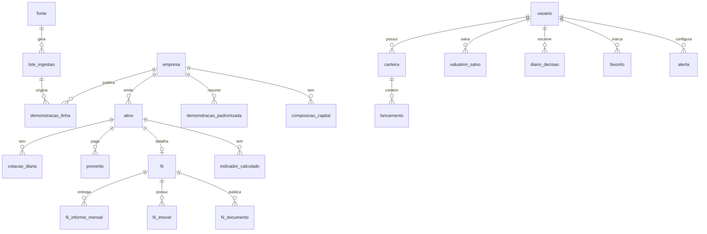

# Arquitetura — Plataforma de Análise de Ações e FIIs

> Fase 0. Documento de arquitetura, sem código de produto. Especificação completa em `docs/ESPECIFICACAO.md`; decisões e motivos em `docs/DECISOES.md`; termos de uso das fontes em `docs/FONTES_DE_DADOS.md`.

## 1. Visão geral

A aplicação tem três partes:

1. **Ingestão.** Jobs agendados baixam dados de fontes oficiais/abertas e gravam os dados brutos normalizados no PostgreSQL. Cada linha guarda a fonte, a data de referência e a data de coleta.
2. **Cálculo.** Um motor de metodologias com funções puras (`backend/app/metodologias/`), sem acesso a banco ou rede, calcula todos os indicadores, rankings e valuations. Uma camada de serviços busca os insumos no banco, chama as funções e devolve cada número junto com a sua procedência.
3. **Apresentação.** API REST (FastAPI) consumida por um frontend Next.js em pt-BR.

Rastreabilidade de ponta a ponta: **número na tela → métrica (fórmula + livro/autor) → insumos → fonte + data de referência + data de coleta.**

## 2. Diagrama dos módulos

```mermaid
flowchart LR
  subgraph Fontes externas
    CVM[CVM Dados Abertos<br/>DFP/ITR/FRE/FII]
    FNET[B3 FNET<br/>documentos FII]
    COT[Provedor de cotações BR<br/>a escolher]
    BCB[BCB SGS<br/>Selic/CDI/IPCA/PTAX]
    TD[Tesouro Transparente<br/>taxas TD]
    SEC[SEC EDGAR XBRL]
    COTUS[Provedor de cotações EUA<br/>a escolher]
    DAM[Damodaran Online]
  end

  subgraph worker[Container worker - APScheduler]
    ING[app/ingestao<br/>um conector por fonte]
    REC[app/jobs/recalculo<br/>indicadores materializados]
  end

  subgraph db[(PostgreSQL)]
    RAW[Dados de origem<br/>com procedência]
    CALC[Indicadores calculados<br/>+ insumos usados]
    USR[Usuários, carteiras,<br/>valuations, diário]
  end

  subgraph api[Container backend - FastAPI]
    MET[app/metodologias<br/>funções puras + registro]
    SRV[app/servicos<br/>busca insumos, chama metodologias]
    RT[app/api<br/>rotas REST]
    EXP[app/exportacao<br/>.xlsx/.csv]
  end

  FE[Container frontend<br/>Next.js + TS + Tailwind + ECharts]

  CVM & FNET & COT & BCB & TD & SEC & COTUS & DAM --> ING
  ING --> RAW
  RAW --> REC
  REC -- usa --> MET
  REC --> CALC
  RT --> SRV
  SRV --> MET
  SRV --> RAW & CALC & USR
  RT --> EXP
  FE -- HTTPS/JSON --> RT
```

Regras de dependência entre módulos (verificadas por teste de importação na Fase 1):

- `metodologias` não importa nada do projeto além de seus próprios tipos; só usa a biblioteca padrão, `numpy`, `pandas` e `scipy` (otimizações de carteira).
- `ingestao` não importa `metodologias` nem `api`.
- `api` só fala com `servicos`; nunca monta SQL nem calcula fórmula.

## 3. Containers (Docker Compose)

| Serviço | Imagem/base | Função |
|---|---|---|
| `db` | `postgres:16` | Banco principal, volume persistente. |
| `backend` | Python 3.12 + FastAPI (uvicorn) | API REST, autenticação, exportações. Roda `alembic upgrade head` na subida. |
| `worker` | mesma imagem do backend | APScheduler com job store no PostgreSQL; executa ingestão e recálculo. |
| `frontend` | Node 20 + Next.js | Interface web. |

Sem Redis/Celery no início: o volume de jobs (algumas dezenas por dia) cabe no APScheduler. Se a carga crescer, a troca para Celery fica isolada em `app/jobs/` (ver `DECISOES.md`).

Os arquivos brutos baixados (ZIP/CSV da CVM, XLS do Damodaran etc.) ficam num volume `dados_brutos/<fonte>/<AAAA-MM-DD>/` para auditoria e reprocessamento sem baixar de novo.

## 4. Modelo de dados

Convenções:

- Nomes de tabelas e colunas em português, `snake_case`.
- Valores monetários em `NUMERIC(20,4)` na moeda original (`moeda` = BRL/USD), sempre em unidades (a escala "mil"/"milhão" da CVM é convertida na ingestão).
- **Procedência obrigatória** em toda tabela de dados de origem: `fonte_id`, `lote_ingestao_id`, `data_referencia`, `coletado_em`. Nenhuma linha de dado de mercado ou contábil entra sem essas colunas (`NOT NULL`).

### 4.1 Procedência

| Tabela | Colunas principais | Observação |
|---|---|---|
| `fonte` | id, codigo (`CVM_DFP`, `CVM_ITR`, `CVM_FII_MENSAL`, `B3_FNET`, `BCB_SGS`, `TESOURO_TD`, `COTACOES_BR`, `SEC_EDGAR`, `COTACOES_US`, `DAMODARAN`…), nome, url, licenca, termos_verificados_em | Uma linha por fonte; textos de licença conferidos em `FONTES_DE_DADOS.md`. |
| `lote_ingestao` | id, fonte_id, iniciado_em, concluido_em, status, arquivo_origem, hash_arquivo, etag/last_modified, linhas_inseridas, linhas_atualizadas, erro | Um registro por execução de job; permite saber de qual arquivo veio cada número. |

### 4.2 Emissores e ativos

| Tabela | Colunas principais |
|---|---|
| `empresa` | id, nome, cnpj (BR) ou cik (EUA), codigo_cvm, pais, setor, subsetor, segmento, segmento_listagem (Novo Mercado, N2…), tipo_plano_contas (`geral`, `banco`, `seguradora`), situacao, + procedência |
| `ativo` | id, ticker, empresa_id (nulo para FII/ETF sem emissor mapeado), classe (`ACAO`, `UNIT`, `FII`, `ETF`, `REIT`, `BDR`, `INDICE`), especie (ON/PN/UNIT), isin, mercado (`B3`, `NYSE`, `NASDAQ`…), moeda, ativo (bool) |
| `composicao_capital` | empresa_id, data_referencia, acoes_ordinarias, acoes_preferenciais, acoes_tesouraria_on, acoes_tesouraria_pn, + procedência — vem do arquivo de composição do capital do DFP/ITR |
| `unit_composicao` | ativo_unit_id, ativo_componente_id, quantidade |

### 4.3 Cotações, séries e parâmetros de mercado

| Tabela | Colunas principais |
|---|---|
| `cotacao_diaria` | ativo_id, data, abertura, maxima, minima, fechamento, volume_financeiro, negocios, fator_ajuste, + procedência. PK (ativo_id, data). Inclui índices (Ibovespa, IFIX, S&P 500) como `ativo` da classe `INDICE`. |
| `evento_societario` | ativo_id, tipo (desdobramento, grupamento, bonificação), data_ex, fator, + procedência — para ajustar preço e LPA. |
| `serie_economica` | codigo (`SELIC_META`, `SELIC_DIARIA`, `CDI`, `IPCA`, `PTAX_VENDA`…), data, valor, + procedência. PK (codigo, data). |
| `titulo_tesouro_taxa` | titulo (`IPCA+`, `Prefixado`, `Selic`…), vencimento, data_base, taxa_compra, taxa_venda, pu_compra, pu_venda, + procedência. |
| `parametro_mercado` | chave (`ERP_EUA_IMPLICITO`, `CRP_BRASIL`, `RISCO_PAIS_DEFAULT_SPREAD`…), valor, data_referencia, + procedência (Damodaran). |
| `beta_setorial` | setor_damodaran, regiao (`US`, `EMERGENTES`, `GLOBAL`), beta_alavancado, beta_desalavancado, de_ratio, aliquota_efetiva, numero_empresas, data_referencia, + procedência. |
| `mapa_setor_damodaran` | setor/subsetor B3 → setor Damodaran (mantido manualmente, versionado em migração de dados). |

### 4.4 Demonstrações financeiras

Guardadas em dois níveis: o dado como veio da fonte e uma visão padronizada usada nos cálculos.

| Tabela | Colunas principais |
|---|---|
| `demonstracao_linha` | empresa_id, documento (`DFP`, `ITR`, `10-K`, `10-Q`), tipo (`BPA`, `BPP`, `DRE`, `DFC_MD`, `DFC_MI`, `DVA`, `DMPL`), consolidado (bool), data_inicio, data_fim, versao, conta_codigo (CD_CONTA ou tag XBRL), conta_descricao, valor, moeda, + procedência. Guarda todas as versões (reapresentações). |
| `mapa_conta` | tipo_plano_contas, conta_codigo / tag XBRL, campo_padronizado, sinal, prioridade — tabela de mapeamento versionada (ex.: `3.01` → `receita_liquida`; `us-gaap:Revenues` → `receita_liquida`). |
| `demonstracao_padronizada` | empresa_id, periodo (`2025-T3`, `2025-A`), tipo_periodo (`trimestre`, `ano`, `acumulado`, `ttm`), consolidado, versao_usada, receita_liquida, custo, lucro_bruto, ebit, depreciacao_amortizacao, ebitda, resultado_financeiro, lucro_antes_ir, lucro_liquido, lucro_liquido_controladores, ativo_total, ativo_circulante, caixa_equivalentes, aplicacoes_financeiras, imobilizado, intangivel, passivo_circulante, emprestimos_cp, emprestimos_lp, patrimonio_liquido, pl_controladores, fco, capex, dividendos_pagos, + procedência (lista de linhas de origem em `insumos` JSONB). |

Regras de padronização (detalhadas na Fase 1):

- Preferência pela demonstração **consolidada**; se não existir, individual (marcado no registro).
- Trimestre isolado do 4º tri = DFP anual − ITR acumulado de 9 meses (DRE e DFC).
- TTM = soma dos 4 últimos trimestres isolados; contas de balanço usam o último balanço.
- Bancos e seguradoras têm plano de contas próprio; campos que não se aplicam (EBIT, EBITDA, dívida líquida) ficam **indisponíveis com motivo**, nunca estimados.

### 4.5 Proventos

| Tabela | Colunas principais |
|---|---|
| `provento` | ativo_id, tipo (`DIVIDENDO`, `JCP`, `RENDIMENTO_FII`, `AMORTIZACAO`, `BONIFICACAO_DINHEIRO`), valor_por_cota (bruto), data_aprovacao, data_com, data_ex, data_pagamento, + procedência. |

O critério de dividend yield (por data-com ou por data de pagamento; JCP bruto ou líquido) é uma pergunta aberta — ver seção 9.

### 4.6 Fundos imobiliários

| Tabela | Colunas principais |
|---|---|
| `fii` | ativo_id, cnpj, nome, segmento, subsegmento, mandato, tipo_gestao, gestora, administrador, publico_alvo, taxa_administracao (texto + valor % a.a. quando numérico), taxa_performance, politica_distribuicao, data_inicio, + procedência |
| `fii_informe_mensal` | fii_id, competencia, patrimonio_liquido, cotas_emitidas, valor_patrimonial_cota, numero_cotistas, cotistas_pf, cotistas_pj, cotistas_bancos, cotistas_outros…, rentabilidade_efetiva_mes, rentabilidade_patrimonial_mes, dividend_yield_mes, ativo_total, imoveis_renda_acabados, imoveis_renda_construcao, imoveis_venda, direitos_reais, instrumentos_financeiros (CRI, LCI, cotas de FII…), caixa, total_passivo, rendimentos_a_distribuir, obrigacoes_aquisicao_imoveis, + procedência |
| `fii_informe_trimestral` | fii_id, competencia, receitas por tipo, despesas, resultado, + procedência |
| `fii_imovel` | fii_id, competencia, nome, endereco, classe (renda/venda/construção), area_m2, numero_unidades, percentual_vacancia, percentual_inadimplencia, percentual_receitas_fii, + procedência |
| `fii_documento` | fii_id, tipo (`INFORME_MENSAL`, `INFORME_TRIMESTRAL`, `INFORME_ANUAL`, `RELATORIO_GERENCIAL`, `FATO_RELEVANTE`…), data_referencia, data_entrega, url_fnet, id_fnet, status, + procedência |
| `indice_composicao` | indice (`IFIX`, `IBOV`), ativo_id, data_referencia, peso, + procedência |

Indicadores derivados (DY 1/3/6/12 m, P/VP, volatilidade, meses negativos, vacância ponderada, obrigações/ativo total, yield patrimonial × yield de mercado) **não** viram colunas: são calculados pelas metodologias e materializados em `indicador_calculado`.

### 4.7 Indicadores calculados

| Tabela | Colunas principais |
|---|---|
| `indicador_calculado` | ativo_id, metrica (id do registro de metodologias, ex.: `graham.valor_intrinseco`), data_referencia, valor (nulo se indisponível), motivo_indisponivel, parametros (JSONB, só os padrão), insumos (JSONB: cada insumo com valor, tabela, fonte, data_referencia, coletado_em), versao_metodologia, calculado_em |

- Materializado para os parâmetros **padrão**, recalculado pelo job após cada ingestão. Serve a lista de ações, o screening com parâmetros padrão e os tooltips de procedência.
- Quando o usuário muda um parâmetro (Taxa Bazin, Taxa Graham etc.), o serviço recalcula **na hora** a partir dos insumos já materializados — sem gravar nada.

### 4.8 Usuários e dados do usuário

| Tabela | Colunas principais |
|---|---|
| `usuario` | id, email (único), hash_senha (argon2), nome, criado_em, ativo, ultimo_login |
| `parametro_usuario` | usuario_id, chave (`taxa_bazin`, `taxa_graham`, `taxa_lynch`, `yield_minimo`…), valor |
| `favorito` | usuario_id, ativo_id |
| `valuation_salvo` | id, usuario_id, ativo_id, metodo (`preco_teto_projetivo`, `dcf_fcff`, `dcf_fcfe`, `gordon`, `ddm_dois_estagios`, `multiplos`, `gordon_ajustado_fii`…), nome, parametros (JSONB), narrativa (texto — ligação narrativa → números de Damodaran), resultado (JSONB), insumos_snapshot (JSONB, para reproduzir o cálculo mesmo após novos dados), criado_em, atualizado_em |
| `carteira` | id, usuario_id, nome, moeda_base, token_compartilhamento (nulo = privada; somente leitura) |
| `lancamento` | id, carteira_id, ativo_id, tipo (`COMPRA`, `VENDA`, `PROVENTO`, `DESDOBRAMENTO`, `GRUPAMENTO`, `BONIFICACAO`, `SUBSCRICAO`), data, quantidade, preco, taxas, origem (`manual`, `importacao_b3`), arquivo_importacao_id |
| `preco_medio_ajuste` | carteira_id, ativo_id, preco_medio_manual, motivo — para o preço médio editável |
| `arquivo_importacao` | id, usuario_id, tipo (`B3_MOVIMENTACAO`, `B3_NEGOCIACAO`), nome_arquivo, hash, processado_em, linhas_ok, linhas_erro |
| `diario_decisao` | id, usuario_id, ativo_id (opcional), data, decisao, tese, premissas (JSONB), data_revisao_prevista, revisao (texto), resultado_observado |
| `alerta` | id, usuario_id, ativo_id, condicao (JSONB: ex. preço ≤ preço teto do valuation X), canal (`email`), ativo, ultimo_disparo |

### 4.9 Diagrama entidade-relacionamento (resumo)



## 5. Motor de metodologias

- Pasta `backend/app/metodologias/`, um arquivo por livro/tema, **uma função pura por métrica**, com docstring citando livro, autor e fórmula.
- Retorno padronizado: `Resultado(valor: Decimal | float | None, motivo_indisponivel: str | None, detalhes: dict)`. Casos de borda (lucro negativo, PL negativo, sem dividendos, EV negativo, divisão por zero) retornam `valor=None` com motivo explícito.
- **Registro único** (`registro.py`): cada métrica declara `id`, nome, livro, autor, fórmula (texto + LaTeX), parâmetros com valores padrão e limites, insumos necessários e limitações. Esse registro alimenta:
  - as páginas "Como é calculado" (o frontend lê `GET /metodologias` — sem texto duplicado);
  - a validação dos parâmetros recebidos pela API;
  - o job de recálculo.

| Arquivo | Conteúdo |
|---|---|
| `indicadores_basicos.py` | P/L, P/VP, EV/EBIT, EV/EBITDA, P/EBIT, P/EBITDA, ROE, ROIC, margens, LPA, VPA, payout, dívida bruta/líquida, DL/EBITDA, endividamento, CAGR, DY |
| `siegel.py` (livro 1) | retorno real, reinvestimento de dividendos, CAPE, prêmio de risco ações × renda fixa |
| `portfolio.py` (livro 2) | fronteira eficiente, CAPM/beta, Sharpe, fatores, otimizador |
| `bogle.py` (livro 3) | impacto de custos no composto, ativo × índice, decomposição do retorno |
| `greenblatt.py` (livro 4) | earnings yield, retorno sobre capital, ranking por soma de posições |
| `bazin.py` (livro 5) | preço teto, critérios de endividamento e regularidade |
| `graham.py` (livro 6) | √(22,5 × LPA × VPA), fórmula revisada, margem de segurança, checklist defensivo |
| `lynch.py` (livro 7) | PEG, índice de Lynch, classificação nas seis categorias |
| `dcf.py` (livro 8) | projeções, FCFF/FCFE, WACC, valor terminal, sensibilidade |
| `damodaran.py` (livro 9) | custo de capital com CRP, Gordon, DDM dois estágios, múltiplos do setor |
| `dalio.py` (livro 10) | matriz de correlação, paridade de risco, All Weather |
| `fii.py` | DY por janela, P/VP, Gordon ajustado, endividamento, yield patrimonial × de mercado |
| `ferramentas.py` | juros compostos, taxas equivalentes, aposentadoria, preço teto projetivo |

## 6. API (visão por recurso)

`/auth` (registro, login, logout) · `/acoes`, `/acoes/{ticker}` · `/fiis`, `/fiis/{ticker}` · `/screening/acoes`, `/screening/fiis` (parâmetros na query/body) · `/valuations` (CRUD + `/comparar` + `/{id}/exportar.xlsx`) · `/carteiras` (CRUD, lançamentos, importação, rentabilidade, otimizador, correlação, `/compartilhada/{token}`) · `/diario` · `/alertas` · `/metodologias` (registro) · `/ferramentas/*` · `/series/{codigo}` · `/exportar` (.xlsx/.csv).

Todo valor numérico vem no formato:

```json
{ "valor": 8.42, "unidade": "x", "motivo_indisponivel": null,
  "metrica": "basico.p_l",
  "procedencia": [ { "insumo": "lucro_liquido_ttm", "fonte": "CVM_ITR", "data_referencia": "2026-06-30", "coletado_em": "2026-08-15T03:12:00-03:00" },
                   { "insumo": "preco", "fonte": "COTACOES_BR", "data_referencia": "2026-10-09", "coletado_em": "2026-10-09T19:40:00-03:00" } ] }
```

O componente `<Numero>` do frontend mostra o valor formatado em pt-BR e, num ícone/tooltip, a fórmula, o livro e a procedência. Respostas de ranking, preço teto e valuation trazem o campo `aviso` com o texto de "não constitui recomendação de investimento", e o frontend o exibe sempre.

## 7. Estrutura de pastas

```
.
├── docker-compose.yml
├── .env.example
├── docs/
│   ├── ESPECIFICACAO.md
│   ├── ARQUITETURA.md
│   ├── DECISOES.md
│   ├── FONTES_DE_DADOS.md
│   └── livros/                # (opcional) anotações do usuário
├── backend/
│   ├── Dockerfile
│   ├── pyproject.toml
│   ├── alembic.ini
│   ├── alembic/versions/
│   ├── app/
│   │   ├── main.py            # FastAPI
│   │   ├── config.py          # leitura do .env
│   │   ├── db/                # sessão, modelos SQLAlchemy
│   │   ├── api/               # rotas (um módulo por recurso)
│   │   ├── esquemas/          # modelos Pydantic de entrada/saída
│   │   ├── servicos/          # busca insumos + chama metodologias
│   │   ├── metodologias/      # funções puras + registro
│   │   ├── ingestao/          # um conector por fonte (cvm, fnet, bcb, tesouro, cotacoes_br, sec, cotacoes_us, damodaran)
│   │   ├── jobs/              # agendamento (APScheduler) e recálculo
│   │   ├── exportacao/        # xlsx/csv
│   │   └── auth/
│   └── tests/
│       ├── metodologias/      # casos calculados à mão
│       ├── ingestao/          # com arquivos de amostra em fixtures/
│       └── api/
├── frontend/
│   ├── Dockerfile
│   ├── package.json
│   ├── src/app/               # rotas App Router: /acoes, /acoes/[ticker], /fiis, /fiis/[ticker], /screening, /valuation, /carteira, /ferramentas, /metodologia/[id]
│   ├── src/componentes/       # Numero, AvisoNaoRecomendacao, TabelaFiltravel, graficos/
│   ├── src/lib/               # cliente da API, formatação pt-BR
│   └── tests/                 # Vitest + Playwright (inclui viewport 375 px)
└── dados_brutos/              # volume, fora do git
```

## 8. Estratégia de atualização dos dados

| Fonte | Frequência | Como detecta mudança | Observações |
|---|---|---|---|
| BCB SGS (Selic, CDI, PTAX) | diária, 20h | busca a partir da última data gravada | IPCA mensal, mesma rotina. |
| Tesouro (taxas TD) | diária, 20h | última `data_base` gravada | |
| Cotações BR (fechamento) e índices | diária, após o fechamento (≈ 19h30) | última data por ativo | Sem intraday no escopo. |
| Proventos BR | diária | chave natural (ativo, tipo, data_com, valor) | |
| CVM DFP/ITR + composição do capital | diária, madrugada | `ETag`/`Last-Modified` + hash do ZIP; só reprocessa o que mudou | Guarda todas as versões; usa a mais recente por período. |
| CVM informes de FII | diária, madrugada | idem | |
| FNET (documentos de FII) | diária | id do documento | Só metadados + link; o PDF não é copiado. |
| SEC EDGAR | diária, para o universo coberto | `submissions` (data do último filing) | Respeita o limite de requisições e o User-Agent exigido. |
| Cotações EUA | diária, após o fechamento de NY | última data por ativo | |
| Damodaran | mensal (verificação) | data de atualização do arquivo | ERP implícito é mensal; dados setoriais e risco país, anual/semestral. |

Fluxo de cada job: abre `lote_ingestao` → baixa arquivo para `dados_brutos/` → valida esquema (colunas esperadas; se mudar, falha alto e não grava) → upsert idempotente por chave natural → fecha o lote → dispara o recálculo apenas dos ativos afetados. Falhas não apagam dados anteriores; a tela mostra a data de referência real do dado, então dado velho aparece como velho.

Carga inicial: script de backfill por fonte (ex.: DFP/ITR desde 2011 para CAGR e histórico de 10 anos do CAPE; cotações desde quando o provedor permitir).

## 9. Fontes de dados escolhidas

Detalhes, custos e termos em `docs/FONTES_DE_DADOS.md`.

| Necessidade | Fonte proposta | Custo |
|---|---|---|
| Demonstrações BR, cadastro, composição do capital, informes de FII | CVM Dados Abertos (ODbL) | Grátis |
| Documentos de FII | B3 FNET (só metadados + link) | Grátis |
| Selic, CDI, IPCA, câmbio | BCB SGS (ODbL) | Grátis |
| Taxas do Tesouro | Tesouro Transparente (CSV oficial) | Grátis |
| Cotações BR | brapi.dev (gratuito na Fase 1) + B3 COTAHIST (histórico) | R$ 0 → ~R$ 100–120/mês com proventos |
| Proventos BR | brapi.dev plano pago (a aprovar) | incluso acima |
| Fundamentos EUA | SEC EDGAR XBRL | Grátis |
| Cotações EUA | a decidir na Fase 7 (EODHD ou Tiingo para desenvolvimento) | US$ 20–50/mês; licença de exibição pública custa mais |
| ERP, risco país, betas setoriais | Damodaran Online (com citação) | Grátis |

## 10. Itens que dependem de decisão

A lista completa de dúvidas está no fim de `docs/DECISOES.md` (seção "Perguntas em aberto"), para ficar num só lugar.
